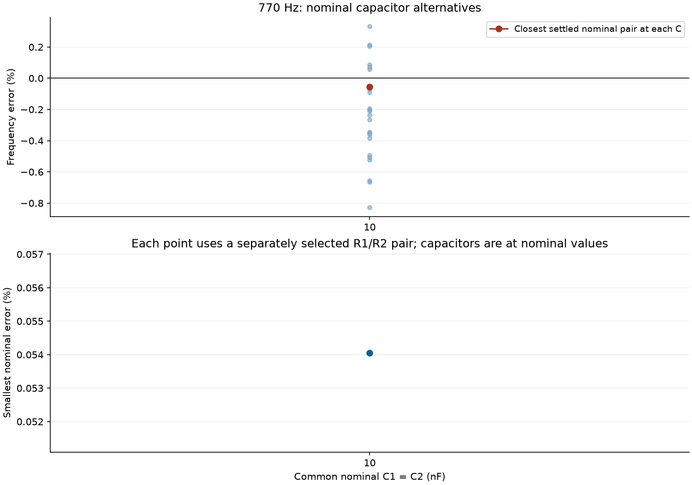
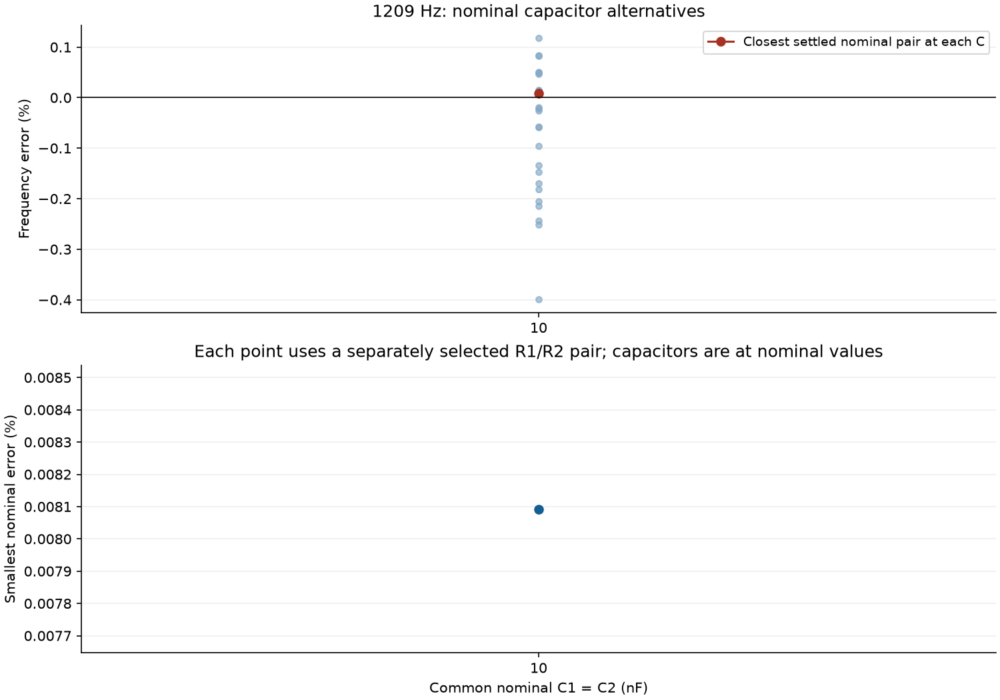
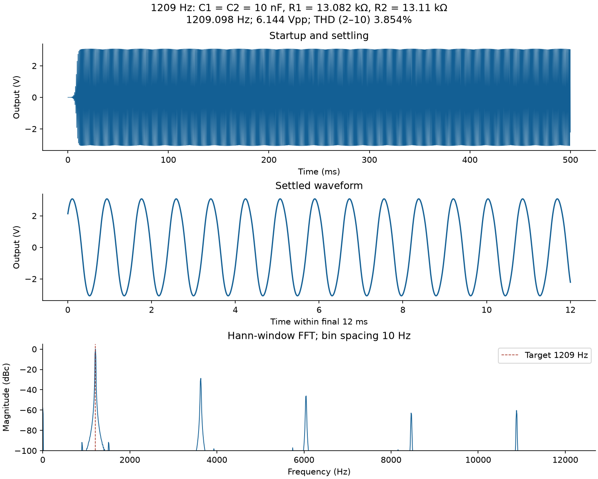
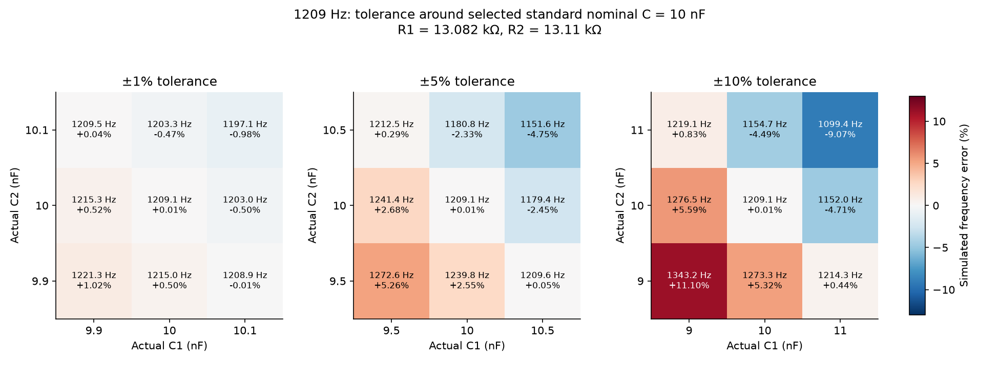

# Expanded nominal capacitor sweep

The original TL074 model, diode models, circuit, supplies, load condition, startup seed, transient duration, and measurement method are retained. Only the nominal-capacitor search is expanded; the original resistor choices are retained.

**1,350 scenario rows; 1,250 unique physical circuits.** The full configured sweep completed.

Nominal C values (nF): 10. Each is an E24 value; E12 membership is identified separately in the tables. C1 and C2 share that nominal value, then independently take −tolerance, nominal, and +tolerance for each of ±1%, ±5%, and ±10%.

## Closest nominal components

Selection uses both capacitors at nominal value. Tolerance-assisted frequency matches are retained in the full tables but are not labeled better nominal designs. The closest frequency is not automatically the lowest-distortion design; THD is reported explicitly.

| Target Hz | C1=C2 nF | R1 series Ω | R2 shunt Ω | Simulated Hz | Error % | THD 2–10 % | Previous 10 nF Hz |
|---:|---:|---:|---:|---:|---:|---:|---:|
| 770 | 10 | 20620 | 20560 | 769.5837 | 0.0541 | 3.825 | 766.2090 |
| 1209 | 10 | 13082 | 13110 | 1209.0978 | 0.0081 | 3.854 | 1210.9206 |

The resistor series parts and nominal capacitor specification are saved in `selected_nominal_values.json`; `circuits/selected_*Hz/circuit.cir` implements each selection. Other C choices and balanced R1=R2 alternatives remain in the ranking tables and `summary.json`.

## Best settled nominal pair at every standard capacitor value

| Target Hz | Nominal C nF | R1 Ω | R2 Ω | Simulated Hz | Error % | THD % |
|---:|---:|---:|---:|---:|---:|---:|
| 770 | 10 | 20620 | 20560 | 769.5837 | 0.0541 | 3.825 |
| 1209 | 10 | 13082 | 13110 | 1209.0978 | 0.0081 | 3.854 |

## Primary ±10% tolerance grid for the selected nominal components

These ranges include only settled points. The table explicitly counts how many of the nine sampled points settled; it is not a probability, yield estimate, or continuous-tolerance guarantee.

| Target Hz | Settled / sampled | Minimum Hz | Maximum Hz | Worst error % |
|---:|---:|---:|---:|---:|
| 770 | 9 / 9 | 699.693 | 854.986 | 11.037 |
| 1209 | 9 / 9 | 1099.361 | 1343.170 | 11.098 |

## Numerical checks and limits

The selected nominal candidates were rerun with the maximum timestep halved from 5 to 2.5 µs. Their changes are in `timestep_convergence.csv`. The nominal tables use the common 5 µs setting for comparability; extra decimal places do not imply corresponding physical accuracy.

- 770 Hz: frequency changes 0.003518% with half the maximum timestep.
- 1209 Hz: frequency changes 0.008301% with half the maximum timestep.

The tolerance grid is deterministic. Capacitor parasitics, manufacturing distributions, resistor manufacturing tolerance, temperature/supply variation, and summing-amplifier loading are outside this stage. Nominal optimization does not eliminate capacitor tolerance; physical parts may still need measurement and trimming. No lab pass/fail limits are assumed.

## 770 Hz figures

## 1209 Hz figures

