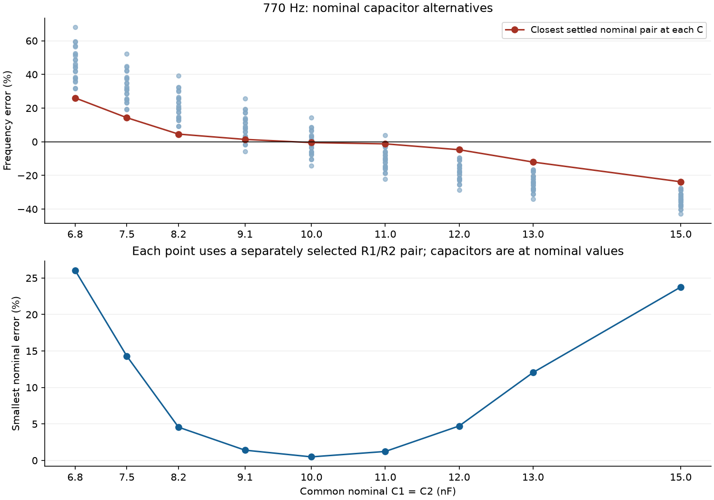
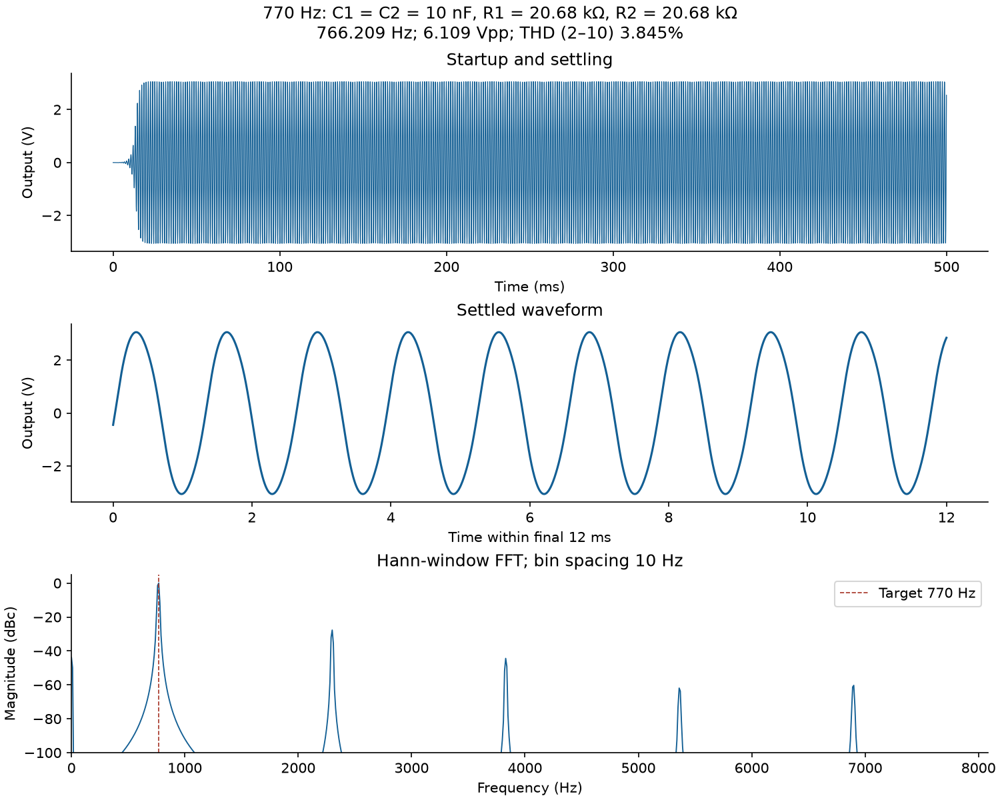
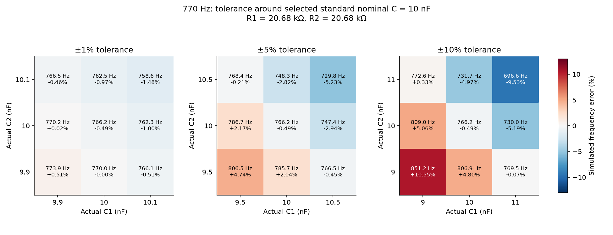
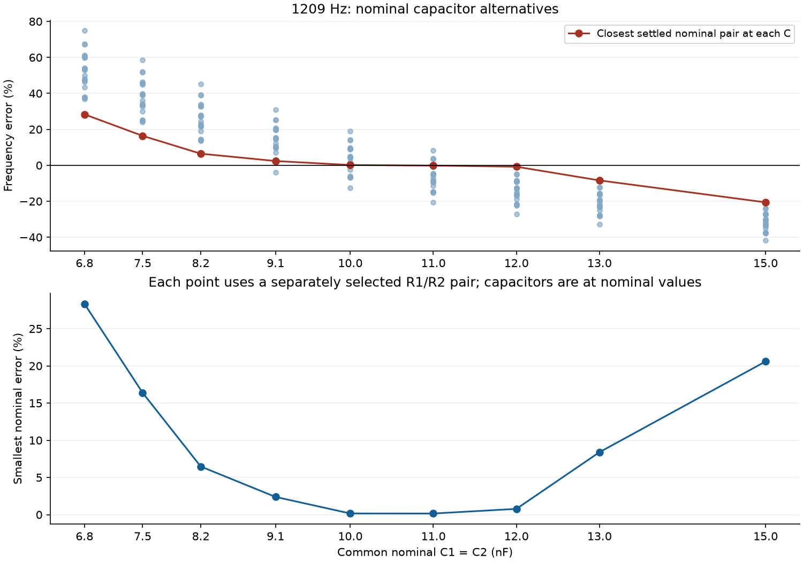
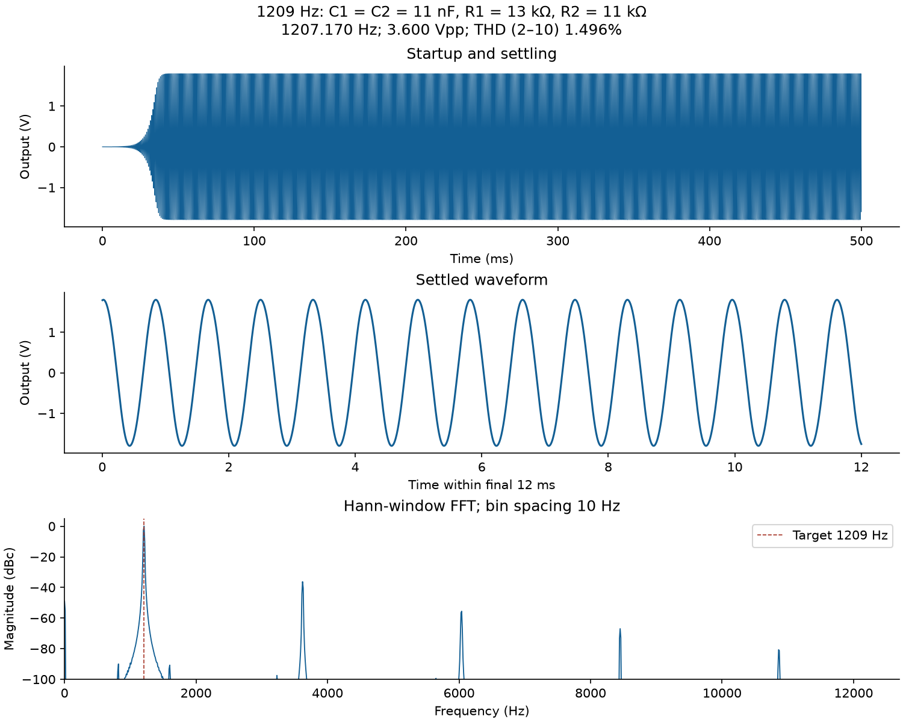
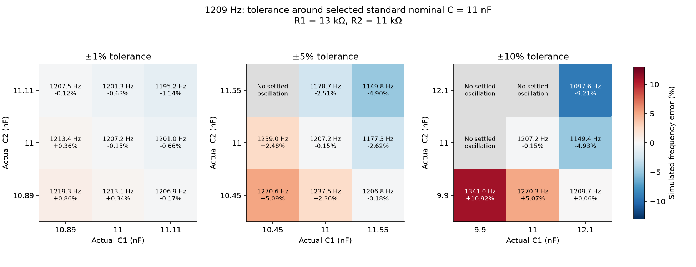

# Expanded nominal capacitor sweep

The original TL074 model, diode models, circuit, supplies, load condition, startup seed, transient duration, and measurement method are retained. Only the nominal-capacitor search is expanded; the original resistor choices are retained.

**12,150 scenario rows; 11,150 unique physical circuits.** The full configured sweep completed.

Nominal C values (nF): 6.8, 7.5, 8.2, 9.1, 10, 11, 12, 13, 15. Each is an E24 value; E12 membership is identified separately in the tables. C1 and C2 share that nominal value, then independently take −tolerance, nominal, and +tolerance for each of ±1%, ±5%, and ±10%.

## Closest nominal components

Selection uses both capacitors at nominal value. Tolerance-assisted frequency matches are retained in the full tables but are not labeled better nominal designs. The closest frequency is not automatically the lowest-distortion design; THD is reported explicitly.

| Target Hz | C1=C2 nF | R1 series Ω | R2 shunt Ω | Simulated Hz | Error % | THD 2–10 % | Previous 10 nF Hz |
|---:|---:|---:|---:|---:|---:|---:|---:|
| 770 | 10 | 20680 | 20680 | 766.2090 | 0.4923 | 3.845 | 766.2090 |
| 1209 | 11 | 13000 | 11000 | 1207.1703 | 0.1513 | 1.496 | 1210.9206 |

The resistor series parts and nominal capacitor specification are saved in `selected_nominal_values.json`; `circuits/selected_*Hz/circuit.cir` implements each selection. Other C choices and balanced R1=R2 alternatives remain in the ranking tables and `summary.json`.

## Best settled nominal pair at every standard capacitor value

| Target Hz | Nominal C nF | R1 Ω | R2 Ω | Simulated Hz | Error % | THD % |
|---:|---:|---:|---:|---:|---:|---:|
| 770 | 6.8 | 24000 | 24000 | 970.6154 | 26.0539 | 3.843 |
| 770 | 7.5 | 24000 | 24000 | 880.1423 | 14.3042 | 3.844 |
| 770 | 8.2 | 24000 | 24000 | 805.0971 | 4.5581 | 3.846 |
| 770 | 9.1 | 20680 | 24000 | 780.8575 | 1.4101 | 4.230 |
| 770 | 10 | 20680 | 20680 | 766.2090 | 0.4923 | 3.845 |
| 770 | 11 | 20000 | 18000 | 760.5097 | 1.2325 | 2.698 |
| 770 | 12 | 18000 | 18000 | 733.6086 | 4.7262 | 3.846 |
| 770 | 13 | 18000 | 18000 | 677.2325 | 12.0477 | 3.847 |
| 770 | 15 | 18000 | 18000 | 587.0108 | 23.7648 | 3.848 |
| 1209 | 6.8 | 15000 | 15000 | 1551.6242 | 28.3395 | 3.835 |
| 1209 | 7.5 | 15000 | 15000 | 1407.1132 | 16.3865 | 3.837 |
| 1209 | 8.2 | 15000 | 15000 | 1287.2283 | 6.4705 | 3.838 |
| 1209 | 9.1 | 13150 | 15000 | 1237.8198 | 2.3838 | 4.232 |
| 1209 | 10 | 13000 | 13150 | 1210.9206 | 0.1589 | 3.913 |
| 1209 | 11 | 13000 | 11000 | 1207.1703 | 0.1513 | 1.496 |
| 1209 | 12 | 11000 | 11000 | 1199.6191 | 0.7759 | 3.840 |
| 1209 | 13 | 11000 | 11000 | 1107.4936 | 8.3959 | 3.841 |
| 1209 | 15 | 11000 | 11000 | 960.0398 | 20.5922 | 3.843 |

## Primary ±10% tolerance grid for the selected nominal components

These ranges include only settled points. The table explicitly counts how many of the nine sampled points settled; it is not a probability, yield estimate, or continuous-tolerance guarantee.

| Target Hz | Settled / sampled | Minimum Hz | Maximum Hz | Worst error % |
|---:|---:|---:|---:|---:|
| 770 | 9 / 9 | 696.624 | 851.237 | 10.550 |
| 1209 | 6 / 9 | 1097.614 | 1341.020 | 10.920 |

## Numerical checks and limits

The selected nominal candidates were rerun with the maximum timestep halved from 5 to 2.5 µs. Their changes are in `timestep_convergence.csv`. The nominal tables use the common 5 µs setting for comparability; extra decimal places do not imply corresponding physical accuracy.

- 770 Hz: frequency changes 0.003481% with half the maximum timestep.
- 1209 Hz: frequency changes 0.008472% with half the maximum timestep.

The tolerance grid is deterministic. Capacitor parasitics, manufacturing distributions, resistor manufacturing tolerance, temperature/supply variation, and summing-amplifier loading are outside this stage. Nominal optimization does not eliminate capacitor tolerance; physical parts may still need measurement and trimming. No lab pass/fail limits are assumed.

## 770 Hz figures

## 1209 Hz figures

