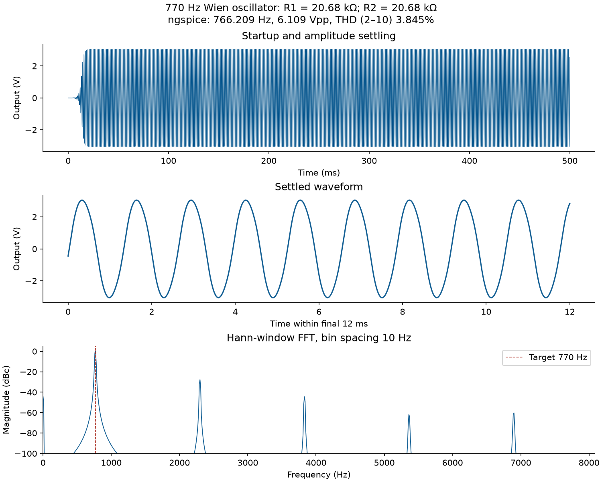
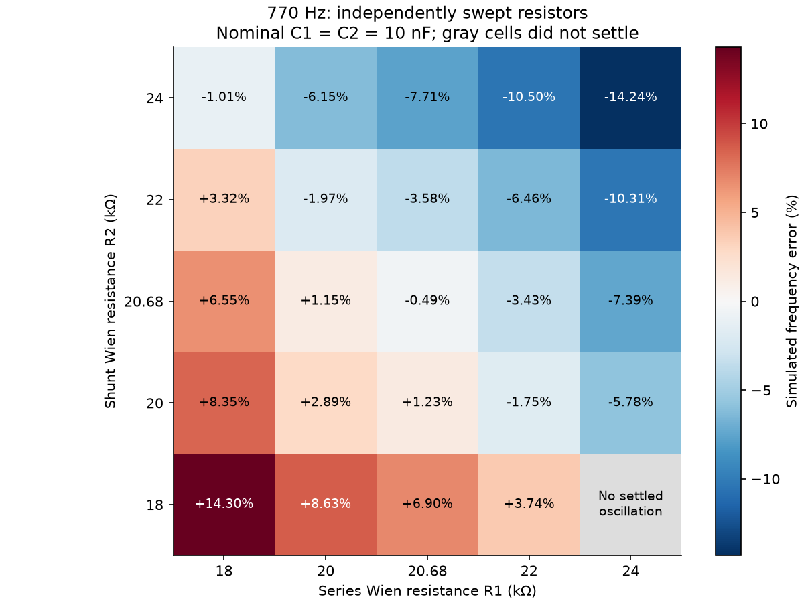
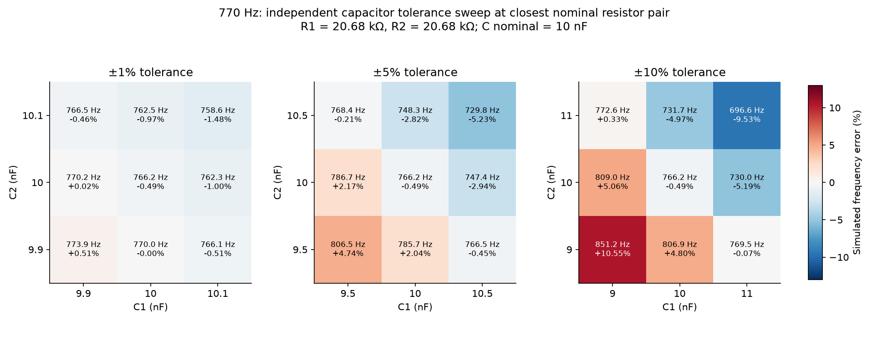
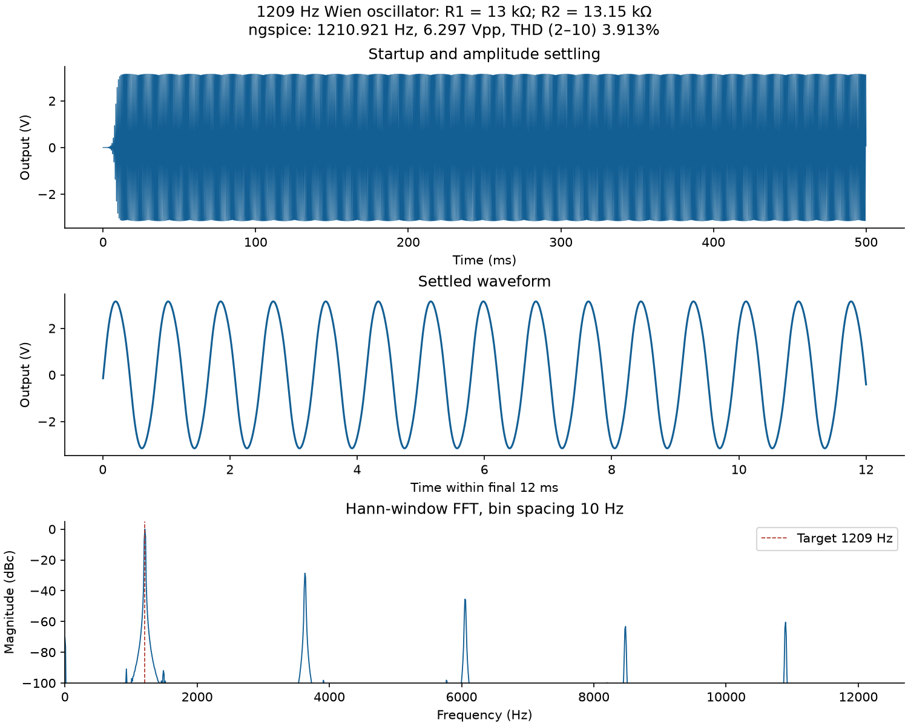
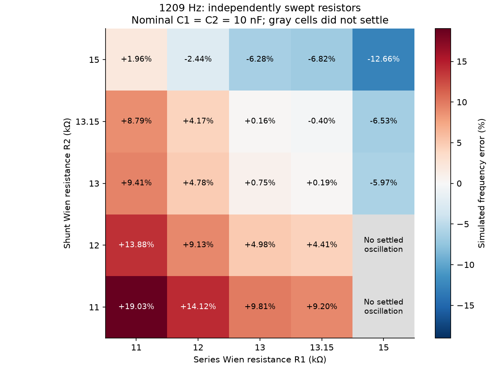
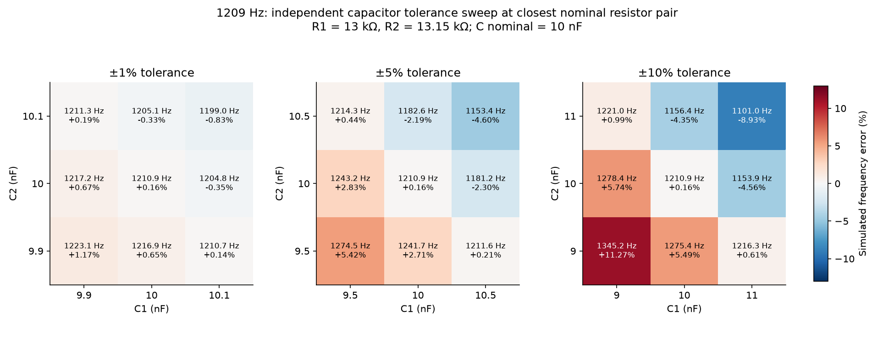

# Independent Wien bridge oscillator results

These are ngspice transient measurements using the supplied TL074.301 model. This stage has no summing amplifier or external output load.

Scenario rows: **1350**. Unique physical circuits: **1250**. Nominal capacitor points shared between tolerance scenarios are simulated once and reused.

Full configured sweep completed.

C1 and C2 each have nominal value 10 nF. Primary tolerance: ±10%; comparisons: ±1%, ±5%. Each capacitor independently takes its lower limit, nominal value, and upper limit. The 3×3 grid is a deterministic sampled grid, not a statistical distribution or manufacturing yield estimate.

## Closest nominal resistor pairs

These minimize nominal simulated frequency error among settled independently swept R1/R2 pairs in this finite search. They are not guaranteed to meet an unspecified lab acceptance limit or all capacitance values.

| Target (Hz) | R1 series (Ω) | R2 shunt (Ω) | Simulated (Hz) | Error (%) | Vpp (V) | THD 2–10 (%) |
|---:|---:|---:|---:|---:|---:|---:|
| 770 | 20680 | 20680 | 766.2090 | 0.4923 | 6.1093 | 3.8455 |
| 1209 | 13000 | 13150 | 1210.9206 | 0.1589 | 6.2972 | 3.9127 |

Exact parts are stored in `selected_nominal_values.json` and implemented in `circuits/selected_*Hz`. The 1209 Hz choice has unequal R1/R2; the generalized network equations apply. Balanced alternatives are retained in `summary.json` and the nominal candidate tables.

## Oscillation status

| Target (Hz) | Status | Scenario rows |
|---:|---|---:|
| 770 | settled_oscillation | 625 |
| 770 | not_settled_within_run | 2 |
| 770 | no_sustained_oscillation | 48 |
| 1209 | settled_oscillation | 611 |
| 1209 | no_sustained_oscillation | 63 |
| 1209 | not_settled_within_run | 1 |

## Primary ±10% capacitor results for the closest nominal candidates

Frequencies below include settled sample points only. A nonsettling point remains explicitly identified in the lookup CSV; omitted frequencies must not be read as a successful result.

| Target (Hz) | Settled points / 9 | Min Hz | Max Hz | Worst sampled error (%) |
|---:|---:|---:|---:|---:|
| 770 | 9 / 9 | 696.624 | 851.237 | 10.550 |
| 1209 | 9 / 9 | 1101.018 | 1345.194 | 11.265 |

For matched capacitors shifting together, ideal frequency scales as 1/C: a ±10% capacitance range alone gives −9.09% to +11.11% frequency shift at fixed R. Accurate nominal resistors therefore do not eliminate capacitor tolerance. See `tolerance_comparison.csv` for the separate ±1%, ±5%, and ±10% cases.

## Numerical verification

Each selected closest nominal candidate was rerun with the maximum timestep halved. The measured changes are recorded in `timestep_convergence.csv`; these are numerical diagnostics, not lab acceptance limits.

- 770 Hz candidate: frequency changes by 0.003481% when the maximum timestep is halved.
- 1209 Hz candidate: frequency changes by 0.008308% when the maximum timestep is halved.

## Waveforms and spectra

