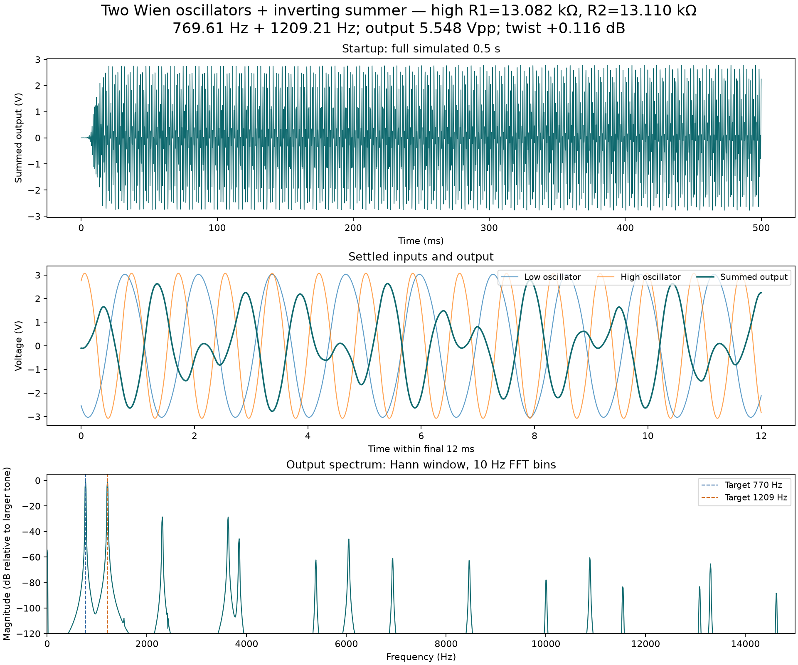
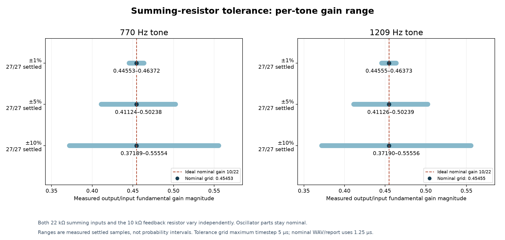
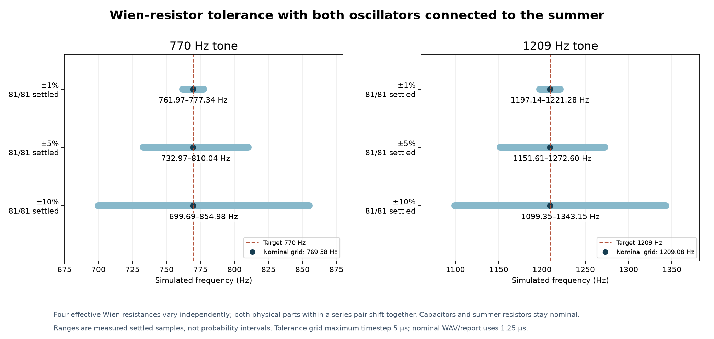
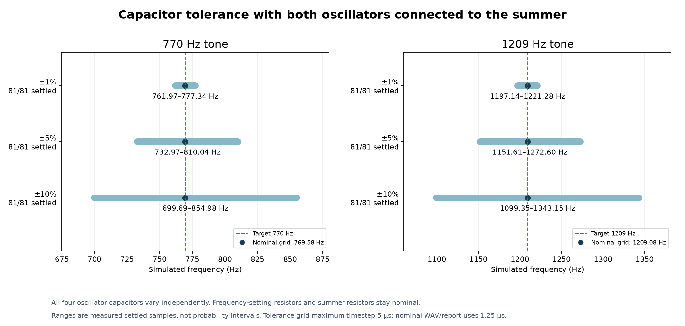

# Two Wien oscillators + summing amplifier: results

**Decoder file:** [dtmf_4_steady_48k.wav](audio/dtmf_4_steady_48k.wav). Intended digit: **4**. Basic spectral checker returns **4**; repeated WAV returns **444** at both 48 kHz and 8 kHz. These are checks of the exported model waveform, not certification of a particular DTMF decoder.

The summer follows the partner calculation: **22 kΩ per input, 10 kΩ feedback**, nominal gain **−0.454545 per tone**. It uses the final refined oscillator components. The fourth TL074 channel is grounded as a follower.

The 1209 Hz resistor choice is pinned to **R1=13,082 Ω / R2=13,110 Ω**. Nominal results below use **1.25 µs** maximum timestep. The original standalone table used **5 µs**; see [matching-timestep comparisons](results/timestep_and_loading_comparison.csv) for numerical and loading effects with the components held fixed.

## Nominal connected circuit

| Target | R1 | R2 | C1=C2 | Standalone frequency | Connected frequency | Shift from loading |
|---:|---|---|---:|---:|---:|---:|
| 770 Hz | 20 kΩ + 620 Ω | 20 kΩ + 560 Ω | 10 nF | 769.6176 Hz | 769.6123 Hz | -0.0053 Hz |
| 1209 Hz | 13 kΩ + 82 Ω | 13 kΩ + 110 Ω | 10 nF | 1209.2245 Hz | 1209.2115 Hz | -0.0130 Hz |

Output: **5.548 Vpp**, peak ±approximately 2.774 V; external load **1 MΩ**. Twist (high/low): **+0.116 dB**. Both oscillators settle by approximately 20 ms under the original bin-based settling measure.

Measured per-tone gain magnitudes: 0.454542 and 0.454540, with phases 179.975° and 179.961°. The nominal summer does not approach the supply rails in this simulation.

The source oscillators retain approximately 3.8% THD from their diode amplitude control. The summed waveform's RMS residual to two fundamental sine waves is 3.845%; this is not single-tone THD. Comparing actual output with the ideal weighted sum gives **0.815 mV AC RMS error**, predominantly finite-gain/phase behavior.

## Tolerance results

Other component groups stay nominal in each separate study. The grids use 5 µs maximum timestep. The numerical/WAV nominal uses 1.25 µs. These ranges describe sampled settled cases; they are not receiver pass limits or manufacturing yields.

| Study | Tolerance | Settled / rows | Low frequency range (Hz) | High frequency range (Hz) | Output Vpp range | Twist range (dB) |
|---|---:|---:|---:|---:|---:|---:|
| Joint selected corners | R ±1%, C ±10% | 16/16 | 692.77–863.61 | 1088.48–1356.69 | 5.49–5.55 | 0.12–0.13 |
| Four capacitors | ±1% | 81/81 | 761.97–777.34 | 1197.14–1221.28 | 5.25–5.85 | -0.80–1.04 |
| Four capacitors | ±5% | 81/81 | 732.97–810.04 | 1151.61–1272.60 | 4.17–7.22 | -4.61–4.87 |
| Four capacitors | ±10% | 81/81 | 699.69–854.98 | 1099.35–1343.15 | 2.58–9.48 | -11.16–11.73 |
| Wien R1/R2 | ±1% | 81/81 | 761.97–777.34 | 1197.14–1221.28 | 5.25–5.85 | -0.80–1.05 |
| Wien R1/R2 | ±5% | 81/81 | 732.97–810.04 | 1151.61–1272.60 | 4.16–7.21 | -4.61–4.88 |
| Wien R1/R2 | ±10% | 81/81 | 699.69–854.98 | 1099.35–1343.15 | 2.57–9.49 | -11.14–11.78 |
| Summer resistors | ±1% | 27/27 | 769.58–769.58 | 1209.08–1209.09 | 5.44–5.66 | -0.05–0.30 |
| Summer resistors | ±5% | 27/27 | 769.58–769.58 | 1209.08–1209.09 | 5.02–6.13 | -0.75–0.99 |
| Summer resistors | ±10% | 27/27 | 769.58–769.58 | 1209.08–1209.09 | 4.54–6.78 | -1.62–1.87 |

The BOM specifies 1% resistors, so ±1% is the primary resistor case. The previous user-specified 10% capacitor tolerance remains the primary capacitor case. Large capacitor tolerance can move the tone frequencies substantially despite the accurate nominal resistor choices; no claim is made that every tolerance case decodes as 4.

## Numerical and load checks

| Check | Low tone (Hz) | High tone (Hz) | Output Vpp | Both settled |
|---|---:|---:|---:|---|
| nominal_half_timestep | 769.6140 | 1209.2180 | 5.5483 | True |
| scope_10Mohm | 769.6123 | 1209.2115 | 5.5483 | True |
| no_external_load | 769.6123 | 1209.2115 | 5.5483 | True |
| load_10kohm_stress | 769.6123 | 1209.2115 | 5.5483 | True |

Coverage: **583 tolerance scenario rows**, **575 tolerance transient runs**, zero simulator failures. 583 rows have both oscillators settled; 0 output rows reach the analysis rail guard. Every emitted physical part value is checked against its scenario definition.

## Files to use

- Decoder input: [steady 48 kHz WAV](audio/dtmf_4_steady_48k.wav), [repeated 48 kHz WAV](audio/dtmf_4_repeated_48k.wav), [steady 8 kHz WAV](audio/dtmf_4_steady_8k.wav).
- Main netlist: [circuit.cir](circuits/nominal/circuit.cir).
- Native time/voltage data: [nominal_native.csv](waveforms/nominal_native.csv).
- Native ngspice raw waveform: [waveform.raw](results/cases/case_cedf2e7ade2b597a/waveform.raw).
- Detailed data: [all tolerance rows](results/tolerance_all.csv), [summary](results/tolerance_summary.csv), [load/numerical checks](results/numerical_and_load_checks.csv).
- More plots: [summing linearity](figures/summing_linearity.png), [wideband FFT](figures/fft_wideband.png).
- Assumptions, reproduction and decoder details: [README](README.md).
